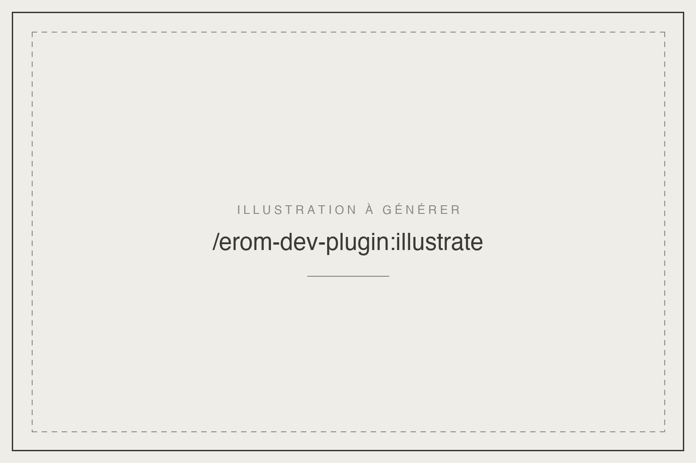

# erom-motion-design

Plugin Claude Code. Boîte à outils de motion design : références décortiquées de vidéos marquantes, guides des générateurs d'images et de musique, banque de bruitages Sonniss, pour aller au-delà des limites de HyperFrames.

## Installation

```
/plugin marketplace add eRom/erom-marketplace
/plugin install erom-motion-design@erom-marketplace
```

## Prérequis

- Plugins `hyperframes` et `remotion`, installés et activés : HyperFrames fabrique le motion, ce plugin lui apporte la matière.
- `bun` et `ffmpeg` pour chercher et mixer les bruitages.
- `rclone` avec un remote `gdrive:` qui donne accès à `sound-fx/GDC2024/`.
- Clés d'API en variables d'environnement, selon les outils utilisés : `GEMINI_API_KEY` (Nanobanana, Lyria), `PIXABAY_API_KEY`, une clé OpenRouter (Seedream).

## Les skills

| Skill | Invocation | Ce qu'elle fait |
|---|---|---|
| `motion-context` | `/erom-motion-design:motion-context` | Point d'entrée : vérifie que HyperFrames et Remotion sont actifs, puis branche références décortiquées, images (Seedream, Nanobanana, Pixabay), musique (Lyria) et bruitages. |
| `sonniss-catalog-audio-fx` | `/erom-motion-design:sonniss-catalog-audio-fx` | Cherche des bruitages dans la banque Sonniss GDC 2024 (609 WAV), les télécharge et les pose en pistes audio dans la composition HyperFrames. |

## Licence

MIT, Romain Ecarnot.
