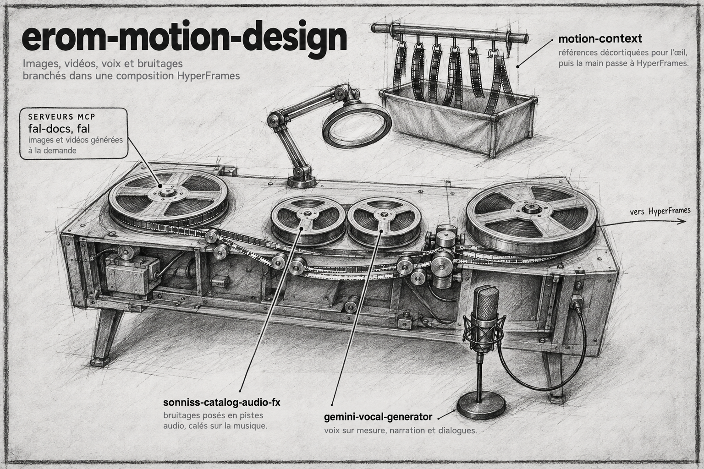

# erom-motion-design

Plugin Claude Code. Boîte à outils de motion design : références décortiquées de vidéos marquantes, guides des générateurs d'images, de vidéos et de musique, banque de bruitages Sonniss, voix Gemini et rétro-ingénierie d'animations front-end, pour aller au-delà des limites de HyperFrames.

## Installation

```
/plugin marketplace add eRom/erom-marketplace
/plugin install erom-motion-design@erom-marketplace
```

## Prérequis

- Plugins `hyperframes` et `remotion`, installés et activés : HyperFrames fabrique le motion, ce plugin lui apporte la matière.
- `bun` et `ffmpeg` pour chercher et couper les bruitages et pour la rétro-ingénierie d'animations, `uv` pour les scripts de voix.
- `rclone` avec un remote `gdrive:` qui donne accès à `sound-fx/GDC2024/`.
- Clés d'API en variables d'environnement, selon les outils utilisés : `GEMINI_API_KEY` (Nanobanana, Lyria, voix), `PIXABAY_API_KEY`, `OPENROUTER_API_KEY` (Seedream, Glimpse).
- Génération vidéo (Seedance 2.5, MiniMax H3) : serveur MCP fal, déclaré par le plugin.

## Les skills

| Skill | Invocation | Ce qu'elle fait |
|---|---|---|
| `motion-context` | `/erom-motion-design:motion-context` | Point d'entrée : vérifie que HyperFrames et Remotion sont actifs, puis branche références décortiquées, images (Seedream, Nanobanana, Pixabay), musique (Lyria) et bruitages. |
| `sonniss-catalog-audio-fx` | `/erom-motion-design:sonniss-catalog-audio-fx` | Cherche des bruitages dans la banque Sonniss GDC 2024 (609 WAV), les télécharge et les pose en pistes audio dans la composition HyperFrames. |
| `gemini-vocal-generator` | `/erom-motion-design:gemini-vocal-generator` | Crée des voix sur mesure (voice design) et synthétise voix off ou dialogues à plusieurs voix avec Gemini TTS, en WAV posé dans la composition HyperFrames. |
| `reverse-animation` | `/erom-motion-design:reverse-animation` | Rétro-conçoit une animation ou une interaction front-end depuis une vidéo : Glimpse (OpenRouter) dit ce qui bouge, une planche-contact image par image mesure durées, stagger et easing, puis spec et code (CSS, GSAP, HyperFrames). |

## Licence

MIT, Romain Ecarnot.
